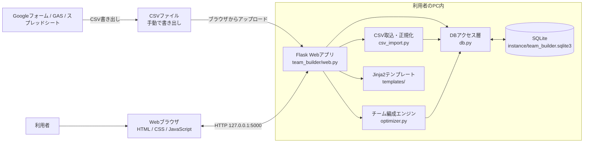
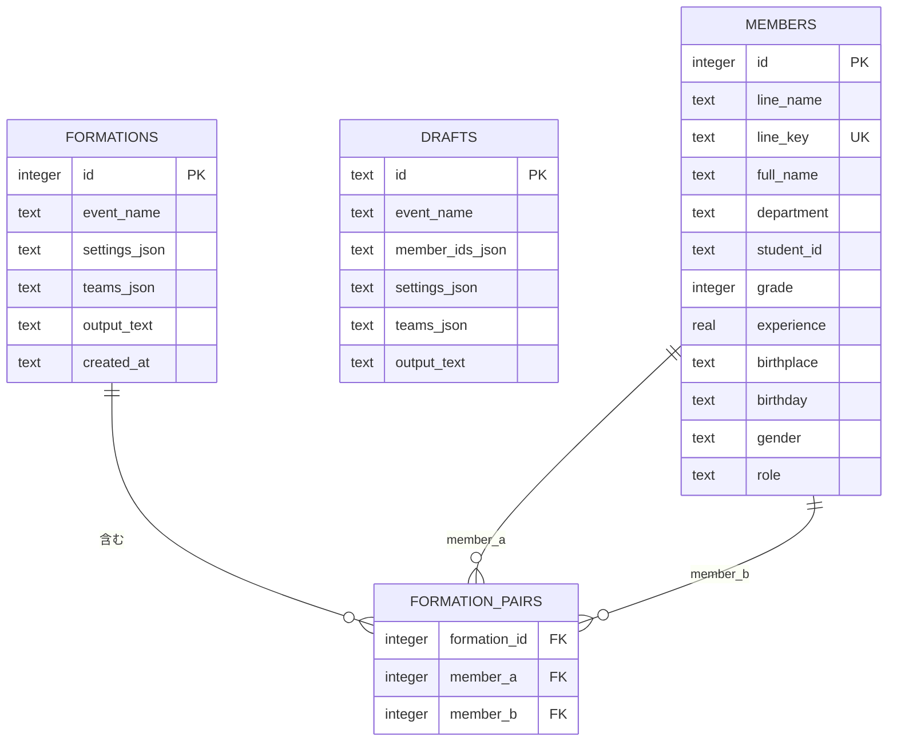
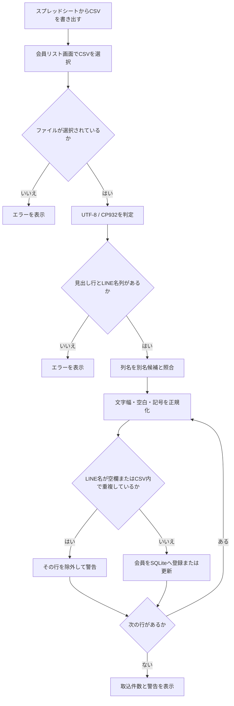
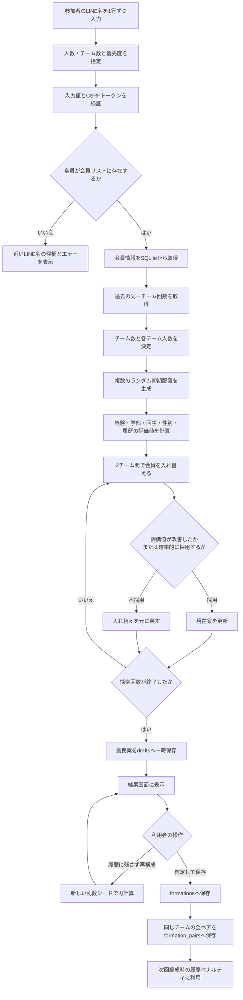
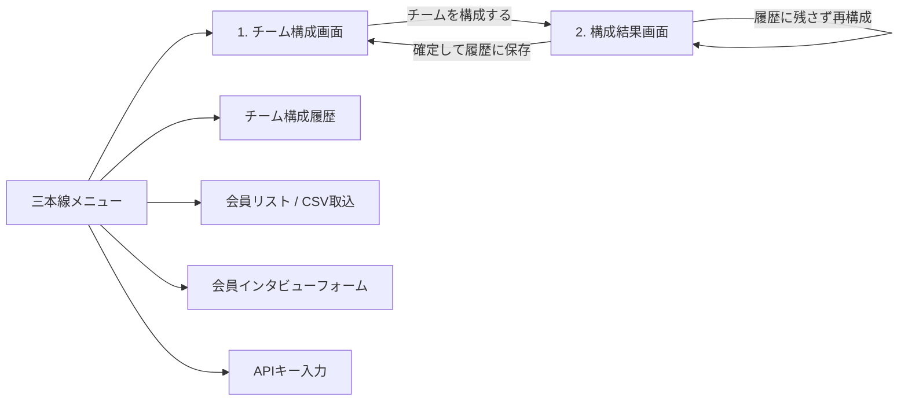

# 技術構成・システム設計

この資料は、バレーボール班編成ツールで使用している技術、ライブラリ、システム構成、データ構造、主要処理フローをまとめたものです。

## 1. システムの概要

本システムは、Googleスプレッドシートから出力した会員CSVを読み込み、参加者のLINE名を指定してチームを編成するローカルWebアプリです。

- Webブラウザから操作する
- PythonのFlaskが画面表示、入力検証、データ処理を担当する
- 会員情報、編成途中の案、確定履歴をSQLiteへ保存する
- チーム編成はPython内の最適化ロジックで計算する
- 通常の利用では外部AI APIや外部サーバーへ会員情報を送信しない

## 2. 使用技術

| 分類 | 技術 | 用途 |
| --- | --- | --- |
| バックエンド | Python 3.11以上 | 入力検証、CSV処理、編成計算、データ保存 |
| Webフレームワーク | Flask 3.1系 | URLルーティング、セッション、画面表示、フォーム処理 |
| テンプレート | Jinja2 | HTMLの動的生成。Flaskの依存ライブラリ |
| データベース | SQLite 3 | 会員、編成案、確定履歴、過去の組み合わせを保存 |
| フロントエンド | HTML5 / CSS3 | 画面構造と白黒のレスポンシブデザイン |
| ブラウザ処理 | Vanilla JavaScript | メニュー開閉、結果テキストのコピー |
| 起動補助 | Windows Batch | 仮想環境の作成、依存関係の導入、アプリ起動 |
| テスト | unittest | CSV取込、編成ロジック、Web画面フローの自動テスト |
| 図表 | Mermaid | GitHub上でシステム図とフロー図を表示 |

## 3. 使用ライブラリ

### 外部ライブラリ

`requirements.txt`で直接指定している外部ライブラリはFlaskだけです。

| ライブラリ | バージョン | 主な用途 |
| --- | --- | --- |
| Flask | `>=3.1,<4` | Webアプリ本体、Blueprint、リクエスト、レスポンス、セッション、テンプレート表示 |
| Jinja2 | Flaskにより導入 | HTMLテンプレートのレンダリング |
| Werkzeug | Flaskにより導入 | WSGI処理、開発用Webサーバーなど |
| Click | Flaskにより導入 | `init-db`コマンドの定義 |
| itsdangerous | Flaskにより導入 | Flaskの署名処理を支えるライブラリ |
| MarkupSafe | Flaskにより導入 | HTML文字列の安全なエスケープ |

### Python標準ライブラリ

| ライブラリ | 主な用途 |
| --- | --- |
| `sqlite3` | SQLiteへの接続とSQL実行 |
| `csv`, `io` | CSVの読込み、書出し、文字列・バイト列の処理 |
| `json` | 編成条件、メンバーID、チーム構成の保存 |
| `random`, `math`, `statistics` | ランダム初期配置、焼きなまし法に近い探索、評価値の計算 |
| `itertools.combinations` | 同じチームになった会員ペアの列挙 |
| `difflib` | LINE名が見つからない場合の近似候補表示 |
| `unicodedata`, `re` | 全角・半角差や空白を吸収した名前・見出しの正規化 |
| `secrets` | CSRFトークン、編成案ID、乱数シードの生成 |
| `datetime` | 履歴保存日時の生成 |
| `pathlib`, `os` | 保存先、秘密鍵ファイル、環境変数の処理 |

## 4. システム構成図



Googleフォーム、GAS、スプレッドシートは会員データの収集元です。現在のチームビルダーはスプレッドシートと直接通信せず、書き出したCSVを手動で読み込みます。

## 5. アプリ内部の構成

| ファイル・フォルダ | 役割 |
| --- | --- |
| `run.py` | Flaskアプリを生成してローカルサーバーを起動 |
| `team_builder/__init__.py` | アプリ設定、保存先作成、Blueprint登録、DB初期化 |
| `team_builder/web.py` | 画面ルーティング、入力検証、編成案、履歴、会員管理 |
| `team_builder/csv_import.py` | CSV文字コード判定、列名照合、正規化、会員の登録・更新 |
| `team_builder/optimizer.py` | チーム人数計算、評価関数、ランダム探索、結果整形 |
| `team_builder/db.py` | SQLiteスキーマ、接続管理、初期化コマンド |
| `templates/` | 各画面のJinja2 HTMLテンプレート |
| `static/style.css` | 白黒デザインとレスポンシブ表示 |
| `static/app.js` | 三本線メニューとコピー操作 |
| `tests/` | CSV、最適化、Webフローの自動テスト |

## 6. データベース構成



- `members`: LINE名を識別キーとして会員情報を保存
- `drafts`: 未確定の編成案と設定を一時保存
- `formations`: 利用者が確定したチーム編成を保存
- `formation_pairs`: 過去に同じチームだった2人の組み合わせを保存

## 7. 会員CSV取込フロー



## 8. チーム編成フロー



## 9. 画面遷移フロー



## 10. 編成ロジック

チーム編成は、複数回のランダム初期配置とメンバー交換を繰り返す、焼きなまし法に近いヒューリスティック探索です。外部AIは使用していません。

評価値は、次のペナルティに画面で指定した0～5の重みを掛けた合計です。値が小さい構成ほど良い案として扱います。

1. チームごとの平均経験年数の差
2. 同じ学部の会員が集中する割合
3. 同じ回生の会員が集中する割合
4. 男女比とチーム間の男女分布差
5. 過去に同じチームだった回数

探索中は評価値が改善する交換を採用します。また、初期段階では一部の悪化する交換も確率的に採用し、局所的な組み合わせに固定されにくくしています。

## 11. セキュリティとプライバシー

- アプリは初期設定で `127.0.0.1` 上だけに起動する
- POST処理はセッション単位のCSRFトークンで検証する
- 未確定の編成案はセッションの編成案IDと一致する場合だけ表示・更新する
- CSVの最大アップロード容量は5MB
- CSV書出し時は先頭が `=`, `+`, `-`, `@` の値をエスケープし、表計算ソフトでの数式実行を防ぐ
- Flaskの秘密鍵は `instance/.secret_key` に自動生成する
- 会員情報と履歴は `instance/team_builder.sqlite3` にローカル保存する
- APIキーはSQLiteやファイルへ保存せず、実行中のPythonプロセスのメモリだけに保持する
- 現在の編成処理はAPIキーや外部AIを使用しない

## 12. テスト範囲

現在の自動テストでは次の内容を確認しています。

- Googleフォーム／スプレッドシート形式の見出しを持つCSVの取込
- 全角・半角、空白、大文字・小文字を吸収する正規化
- チーム人数と経験年数のバランス
- 過去に同じチームだったペアを避ける履歴評価
- CSV取込から構成、再構成、履歴保存までのWebフロー

```powershell
python -m unittest discover -s tests -v
```

